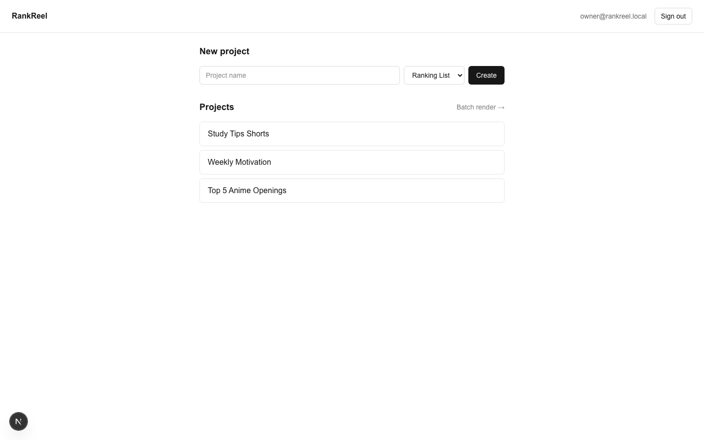
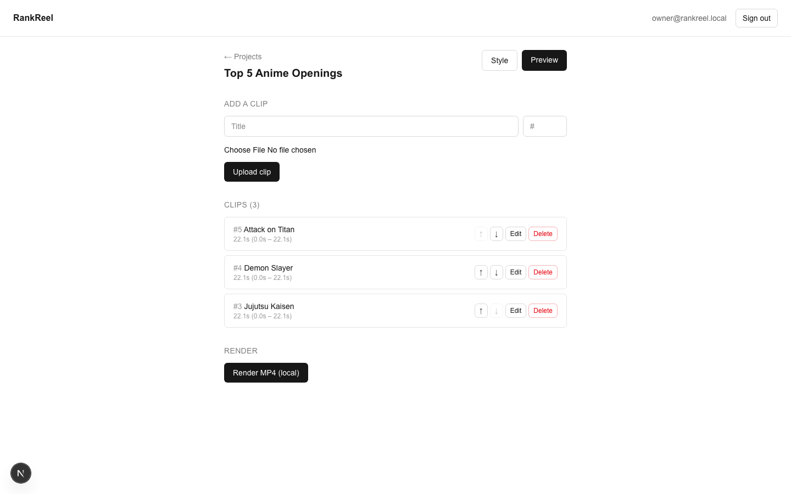
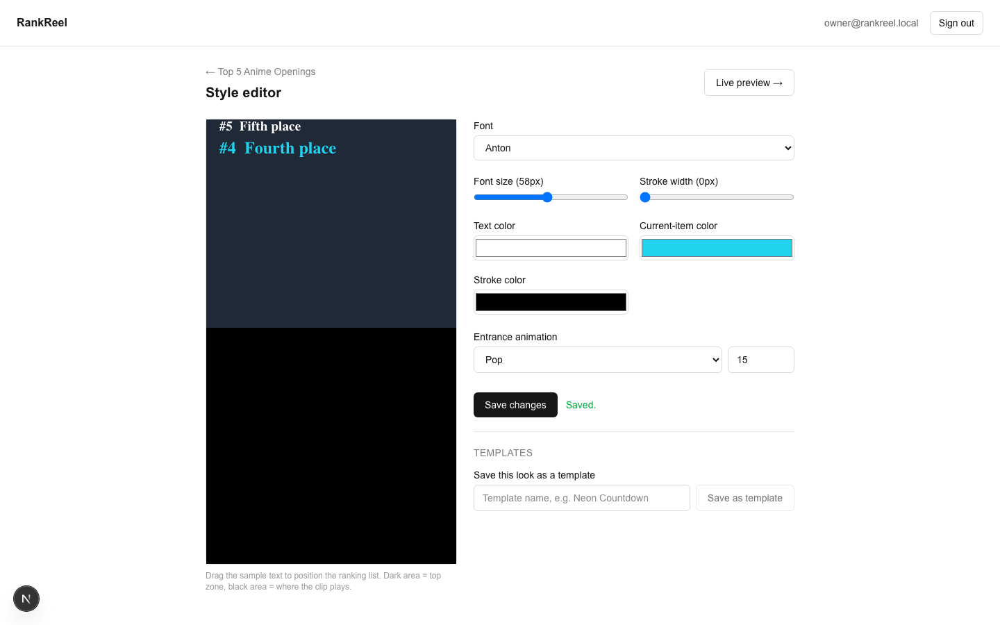
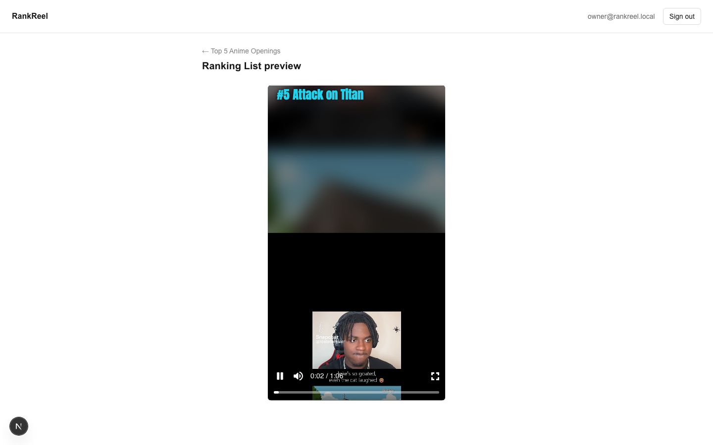
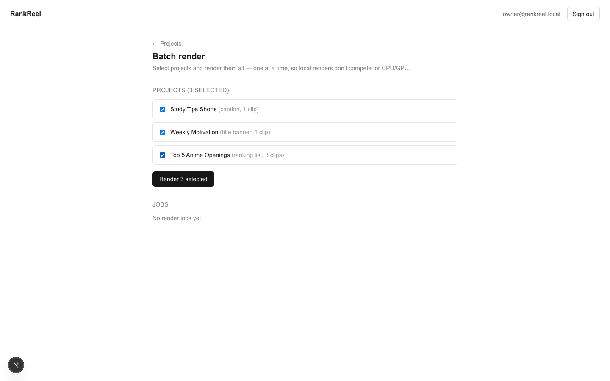
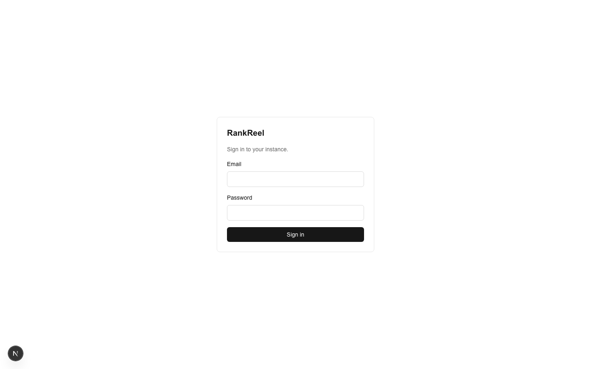

<div align="center">

# 🎬 RankReel

### Free, Open-Source, Self-Hosted Video Generator for YouTube Shorts, TikTok & Instagram Reels

**Turn raw clips into viral vertical videos — ranking-list countdowns, title-banner reels, and
auto-captioned Shorts — with full control over fonts, colors, animation, and one-click MP4 export.**

Built with **Next.js**, **Remotion**, **Supabase**, and **Konva** — deploy it to your own
infrastructure, keep 100% ownership of your content and data, no subscriptions, no vendor lock-in.

[](LICENSE)
[](https://github.com/amjadiqbal/rankreel/releases)
[](CONTRIBUTING.md)
[](https://nextjs.org)
[](https://www.remotion.dev)
[](https://supabase.com)
[](https://github.com/amjadiqbal/rankreel/stargazers)

[Features](#-features) •
[Screenshots](#-screenshots) •
[Getting Started](#-getting-started-self-hosting) •
[Contributing](#-contributing) •
[Sponsors](#-sponsors) •
[Hire Me](#-need-custom-work)

</div>

---

## 📖 About

**RankReel** is a self-hosted, open-source alternative to closed SaaS "Shorts maker" tools. It's a
browser-based video generator purpose-built for creating **YouTube Shorts**, **TikTok clips**, and
**Instagram Reels** in the formats that actually perform: **Top 5 / ranking-list countdown videos**,
**title-banner highlight clips**, and **auto-captioned short-form videos** — complete with a visual
style editor, custom fonts, entrance animations, reusable templates, and **local, unattended batch
MP4 rendering** powered by [Remotion](https://www.remotion.dev).

No monthly fees. No usage limits. No one else's servers touching your footage. You run it, you own it.

## ✨ Features

- 🏆 **Ranking List videos** — numbered countdown (#N → #1) that fills in as each clip plays, blurred
  backdrop, letterboxed clip.
- 🎙️ **Title Banner & Caption videos** — full-bleed clips with a styled title line or pill-style
  caption.
- 🎨 **Visual style editor** — drag-to-position text (Konva canvas), per-element color & stroke,
  custom font upload or a curated Google Fonts picker, entrance animations (fade / slide / pop).
- 💾 **Reusable templates** — save a look once, apply it to any future project.
- 📦 **Local batch rendering** — select multiple projects and render them all to real MP4 files,
  unattended, with a live progress dashboard — no cloud rendering bill required.
- 🔐 **Real authentication & data isolation** — Supabase Auth + Postgres Row-Level Security. Your
  clips and renders are private by default.
- 🧩 **100% self-hosted** — Next.js App Router + Supabase (Postgres/Auth/Storage), deployable to your
  own Vercel + Supabase project. No RankReel-run backend, ever.

## 📸 Screenshots

<table>
<tr>
<td width="50%">

**Dashboard — all your projects**


</td>
<td width="50%">

**Project workspace — upload, reorder, render**


</td>
</tr>
<tr>
<td width="50%">

**Style editor — drag-to-position, fonts, colors, animation**


</td>
<td width="50%">

**Live preview — real footage, real styling, real time**


</td>
</tr>
<tr>
<td width="50%">

**Batch render — multiple projects, one queue**


</td>
<td width="50%">

**Sign-in — single-owner, private by default**


</td>
</tr>
</table>

## 🧱 Tech Stack

| Layer | Choice |
|---|---|
| Framework | [Next.js](https://nextjs.org) 16 (App Router) + TypeScript |
| Database / Auth / Storage | [Supabase](https://supabase.com) (Postgres, Auth, Storage, RLS) |
| Video rendering | [Remotion](https://www.remotion.dev) (`@remotion/renderer`, local — no cloud bill) |
| In-browser editor canvas | [Konva](https://konvajs.org) (`react-konva`) |
| Styling | Tailwind CSS v4 |
| Hosting target | Vercel (app) + your own Supabase project (data) |

## 🚀 Getting Started (self-hosting)

RankReel is designed to run as **your own deployment**, not a shared service.

1. **Create a [Supabase](https://supabase.com) project** (or run one locally via the
   [Supabase CLI](https://supabase.com/docs/guides/local-development)).
2. **Clone and install:**
   ```bash
   git clone https://github.com/amjadiqbal/rankreel.git
   cd rankreel
   npm install
   ```
3. **Configure environment:** copy `.env.example` to `.env.local` and fill in your Supabase URL +
   anon key + service-role key.
4. **Run the database migrations** in `supabase/migrations/` against your project (Supabase Dashboard
   → SQL Editor, or `supabase db push` with the CLI).
5. **Create your owner account:**
   ```bash
   npm run create-owner -- you@example.com "a strong password"
   ```
6. **Disable public signups** in Supabase Dashboard → Authentication → Sign In / Providers → Email.
   This is what keeps it a single-owner app.
7. **Run it:**
   ```bash
   npm run dev
   ```
   Open `http://localhost:3000` — or deploy the app to [Vercel](https://vercel.com) with the same
   environment variables set.

Forgot your password? `npm run reset-password -- you@example.com "new password"` — no reset email
needed, it uses your service-role key directly.

> **Note:** Video rendering runs locally (via `@remotion/renderer`), not on Vercel serverless
> functions or a paid cloud render farm — see [CONTRIBUTING.md](CONTRIBUTING.md) for why and how to
> swap in a cloud renderer later if you need one.

## 🤝 Contributing

Contributions of all sizes are welcome — bug fixes, new features, docs, or just filing a well-written
issue. Please read **[CONTRIBUTING.md](CONTRIBUTING.md)** first — it covers:

- Dev environment setup
- Branch, commit, and pull request conventions
- **Semantic versioning** and how releases/tags are cut
- Code style and guardrails (what *not* to add — no billing, no telemetry, no Vercel-hosted rendering)

Community behavior is governed by the [Code of Conduct](CODE_OF_CONDUCT.md). Found a security issue?
**Do not** open a public issue — see [SECURITY.md](SECURITY.md) for private disclosure.

### 🏷️ Versioning & Releases

RankReel follows [Semantic Versioning 2.0.0](https://semver.org) (`MAJOR.MINOR.PATCH`) and ships
tagged [GitHub Releases](https://github.com/amjadiqbal/rankreel/releases) with changelogs. See
[CONTRIBUTING.md → Versioning & Releases](CONTRIBUTING.md#versioning--releases) for exactly how tags
are cut and what bumps which number.

## 💖 Sponsors

RankReel is free and will stay free and open-source. If it saves you time or money, consider
supporting its development:

<a href="https://github.com/sponsors/amjadiqbal">
  
</a>

No sponsors yet — **be the first!** Sponsors get a shout-out here and on release notes.

## 👥 Contributors

Thanks to everyone who contributes to RankReel!

<a href="https://github.com/amjadiqbal/rankreel/graphs/contributors">
  
</a>

Want to see your avatar here? See [Contributing](#-contributing) above.

## 💼 Need custom work?

Need a custom feature, a private fork, integration help, or a different self-hosted tool built from
scratch? I'm available for freelance work.

**👉 [Hire me on Upwork](https://urlshortly.com/upwork)**

## 📄 License

[MIT](LICENSE) — do what you like with it, including running it commercially; just keep the license
notice. See [CONTRIBUTING.md](CONTRIBUTING.md) for the project's open-source ground rules (no
telemetry, self-hosted only, etc).

---

<div align="center">

**⭐ If RankReel is useful to you, consider starring the repo — it genuinely helps others find it.**

</div>
